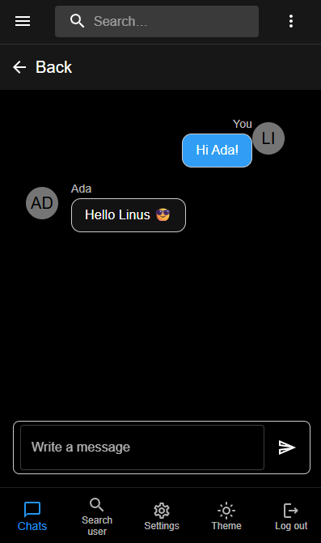
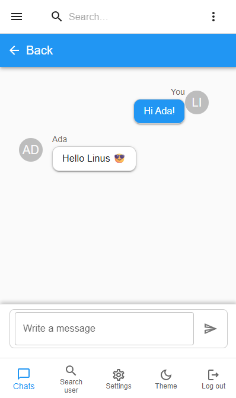
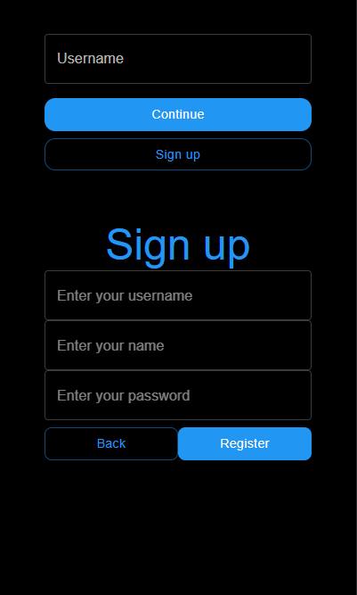
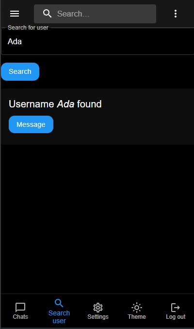

# talkChat

A lightweight real-time chat application built with Socket.IO, React, and Material UI.

## Overview
talkChat provides real-time messaging, simple room support, and a responsive UI built with Material UI. This README covers quick setup, features, development notes.

## Demo / Screenshots

## Features
- Real-time messaging via Socket.IO
- Room / channel support
- Responsive UI using Material UI components
- Lightweight client + server structure suitable for local development and testing

## Tech stack
- Frontend: React
- Styling & UI: Material UI
- Real-time: Socket.IO
- Backend: Node.js (Express + Socket.IO)
- Dev tooling: npm / yarn

## Quick start (development)
1. Clone the repo
   - git clone <https://github.com/anttitulenheimo/talkChat>
2. Install dependencies (both client & server if split)
   - cd talkChat
   - npm install
3. Start the server
   - npm run start:server
4. Start the client
   - npm run start:client
5. Open http://localhost:3000 (or configured port)

Adjust scripts above to match package.json script names in your project.

## Project structure (typical)
- client/ — React app
- server/ — Node/Express + Socket.IO server
- Demopics/ — Demo images used in this README

## Development notes
- Socket.IO docs: https://socket.io/docs/v4/
- React docs: https://react.dev/
- Material UI docs: https://mui.com/material-ui/all-components/
- Use the browser console and server logs to debug socket connection and events.

## Contributing
- Create a branch for your change: git checkout -b feature/your-feature
- Open a pull request with a clear description
- Include screenshots for UI changes (place them in Demopics/ and update README if needed)

## License
MIT

